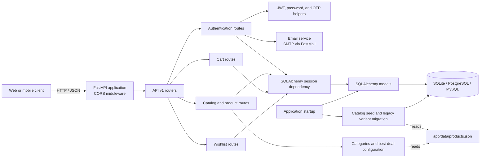
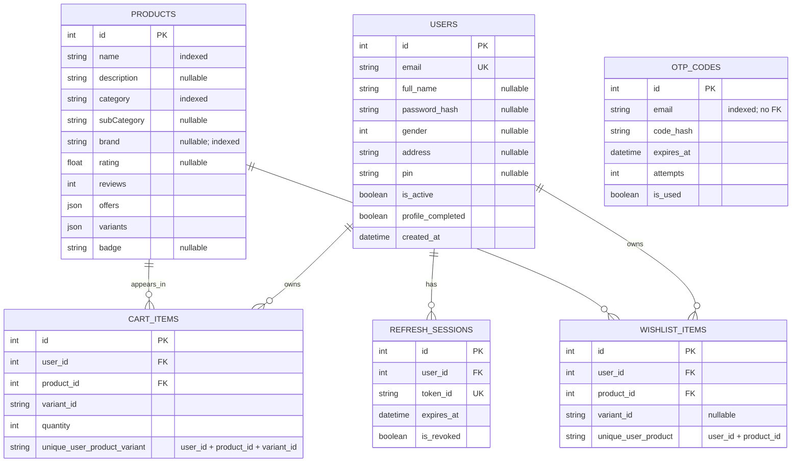

# ShopKart API

ShopKart is a FastAPI service for authentication, product catalog browsing, carts, and wishlists. It uses SQLAlchemy for persistence and supports SQLite, PostgreSQL, and MySQL connection URLs.

## Architecture



### Main code areas

| Area | Responsibility |
| --- | --- |
| `app/main.py` | Loads configuration, creates tables, runs catalog migrations/seeding, configures CORS, and mounts the API router. |
| `app/api/v1/endpoints/` | HTTP endpoints for auth, catalog, products, cart, and wishlist operations. |
| `app/api/deps.py` | Shared authentication dependencies, including the current-user dependency. |
| `app/schemas/` | Pydantic request and response schemas. |
| `app/models/` | SQLAlchemy table models. |
| `app/db/session.py` | Database engine, session factory, and database compatibility helpers. |
| `app/core/security.py` | JWT and OTP creation, hashing, and expiry settings. |
| `app/services/` | Catalog serialization/seeding/migrations and email configuration. |

## Database tables and relationships

The diagram below documents the six SQLAlchemy tables currently declared by the application. `users` and `products` are parent tables; cart and wishlist rows link users to products. Product variants are embedded as JSON in `products.variants`, so they are not a separate current table.



### Relationship details

| Parent | Child | Cardinality | Foreign key / constraint |
| --- | --- | --- | --- |
| `users` | `cart_items` | One user to many cart rows | `cart_items.user_id → users.id`; deleting a user cascades to its cart rows. |
| `products` | `cart_items` | One product to many cart rows | `cart_items.product_id → products.id`; deleting a product cascades to its cart rows. |
| `users` | `wishlist_items` | One user to many wishlist rows | `wishlist_items.user_id → users.id`; no delete cascade is declared on this FK. |
| `products` | `wishlist_items` | One product to many wishlist rows | `wishlist_items.product_id → products.id`; deleting a product cascades to its wishlist rows. |
| `users` | `refresh_sessions` | One user to many refresh sessions | `refresh_sessions.user_id → users.id`; no delete cascade is declared on this FK. |
| — | `otp_codes` | No relational FK | OTP records are looked up by email; the schema does not link them to `users.id`. |

`cart_items` enforces one row per `(user_id, product_id, variant_id)`. `wishlist_items` enforces one row per `(user_id, product_id)`; its `variant_id` is optional metadata and does not change that uniqueness rule. Both `cart_items` and `wishlist_items` contain foreign keys to `users` and `products`, although only the product model declares an ORM relationship property.

### Product variants and legacy data

Current product variant data (including variant IDs, price, stock, and images) is stored inside the `products.variants` JSON column. The startup migration contains compatibility logic for a legacy `product_variants` table and copies its contents into that JSON column when appropriate. `product_variants` is not declared as a current SQLAlchemy model and is not part of the current entity relationship diagram.

## Running locally

Install dependencies from `requirements.txt`, set any required environment variables, then start the API with:

```bash
uvicorn app.main:app --reload
```

The default database URL is `sqlite:///./auth.db`. Set `DATABASE_URL` to use another supported database. The product catalog is loaded from `app/data/products.json` when the database has no products. Authentication and email settings are configured with environment variables; see `app/core/security.py` and `app/services/email.py` for the names and defaults.
