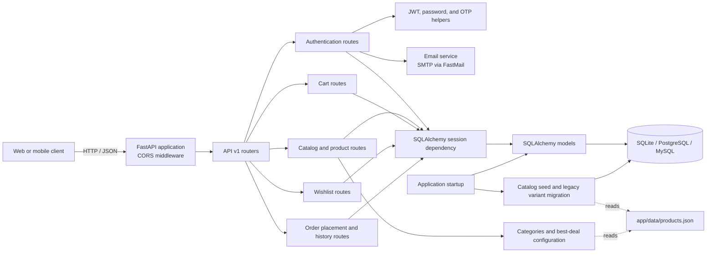
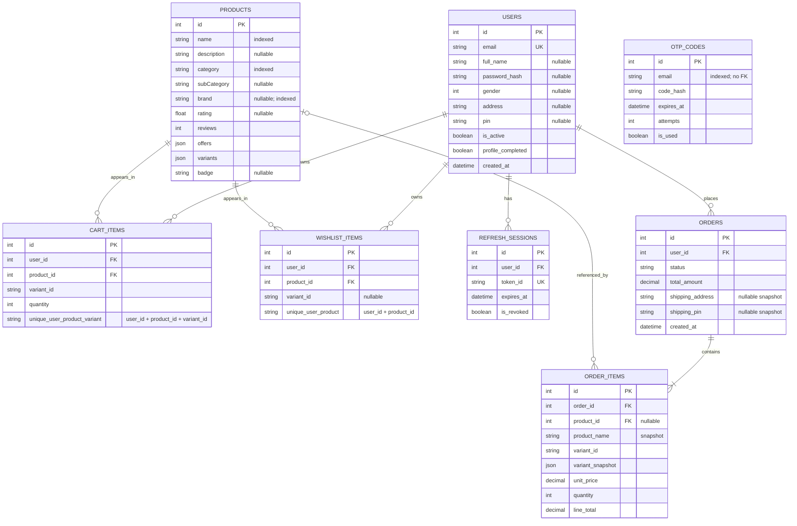

# ShopKart API

ShopKart is a FastAPI service for authentication, product catalog browsing, carts, and wishlists. It uses SQLAlchemy for persistence and supports SQLite, PostgreSQL, and MySQL connection URLs.

## Architecture



### Main code areas

| Area | Responsibility |
| --- | --- |
| `app/main.py` | Loads configuration, creates tables, repairs legacy refresh-session keys, runs catalog migrations/seeding, configures CORS, and mounts the API router. |
| `app/api/v1/endpoints/` | HTTP endpoints for auth, catalog, products, cart, wishlist, and order operations. |
| `app/api/deps.py` | Shared authentication dependencies, including the current-user dependency. |
| `app/schemas/` | Pydantic request and response schemas. |
| `app/models/` | SQLAlchemy table models. |
| `app/db/session.py` | Database engine, session factory, and database compatibility helpers. |
| `app/core/security.py` | JWT and OTP creation, hashing, and expiry settings. |
| `app/services/` | Catalog serialization/seeding/migrations and email configuration. |

## Database tables and relationships

The diagram below documents the eight SQLAlchemy tables currently declared by the application. `users` and `products` are parent tables; cart and wishlist rows link users to products. Orders belong to users and contain item snapshots. Product variants are embedded as JSON in `products.variants`, so they are not a separate current table.



### Relationship details

| Parent | Child | Cardinality | Foreign key / constraint |
| --- | --- | --- | --- |
| `users` | `cart_items` | One user to many cart rows | `cart_items.user_id → users.id`; deleting a user cascades to its cart rows. |
| `products` | `cart_items` | One product to many cart rows | `cart_items.product_id → products.id`; deleting a product cascades to its cart rows. |
| `users` | `wishlist_items` | One user to many wishlist rows | `wishlist_items.user_id → users.id`; no delete cascade is declared on this FK. |
| `products` | `wishlist_items` | One product to many wishlist rows | `wishlist_items.product_id → products.id`; deleting a product cascades to its wishlist rows. |
| `users` | `refresh_sessions` | One user to many refresh sessions | `refresh_sessions.user_id → users.id`; no delete cascade is declared on this FK. |
| `users` | `orders` | One user to many orders | `orders.user_id → users.id`; order history is scoped to the authenticated user. |
| `orders` | `order_items` | One order to one or more line items | `order_items.order_id → orders.id`; deleting an order cascades to its items. |
| `products` | `order_items` | One product may be referenced by many order items | Nullable `order_items.product_id → products.id` with `ON DELETE SET NULL`; order item names, variant, and prices are snapshots. |
| — | `otp_codes` | No relational FK | OTP records are looked up by email; the schema does not link them to `users.id`. |

`cart_items` enforces one row per `(user_id, product_id, variant_id)`. `wishlist_items` enforces one row per `(user_id, product_id)`; its `variant_id` is optional metadata and does not change that uniqueness rule. Both `cart_items` and `wishlist_items` contain foreign keys to `users` and `products`, although only the product model declares an ORM relationship property.

### Product variants and legacy data

The `POST /orders` endpoint validates the authenticated user's delivery address and PIN, cart contents, selected variants, stock limits, and total before saving an order, decrementing the purchased stock, and clearing the cart in one transaction. `GET /orders` returns only that user's orders, newest first, with item snapshots and pagination (`page`, `pageSize`, maximum 100). It also accepts one date filter at a time:

`POST /wishlist/{product_id}/cart` moves a saved variant into the authenticated user's cart and removes it from the wishlist atomically. `POST /cart/items` also removes a matching wishlist variant when adding it to the cart. Both operations preserve the wishlist entry if stock validation or the database transaction fails. See `CART_API.md` for request and response details.

- `duration=1` through `duration=36` for a rolling window ending now (UTC), where the value is a number of months.
- `year=2025` for orders placed during that calendar year (UTC).

For example: `GET /orders?page=1&pageSize=20&duration=6` or `GET /orders?year=2025`. Values outside the 1–36 month range or supplying both `duration` and `year` return HTTP 422. The total count and page count are calculated after applying the selected filter. Both endpoints require a valid access token in the `Authorization: Bearer <token>` header.

Current product variant data (including variant IDs, price, stock, and images) is stored inside the `products.variants` JSON column. The startup migration contains compatibility logic for a legacy `product_variants` table and copies its contents into that JSON column when appropriate. `product_variants` is not declared as a current SQLAlchemy model and is not part of the current entity relationship diagram.

On PostgreSQL, startup also repairs legacy `refresh_sessions` tables by reassigning duplicate or null session IDs without deleting sessions, ensuring the `id` primary key and unique `token_id` index, and synchronizing the ID sequence.

## Running locally

Install dependencies from `requirements.txt`, set any required environment variables, then start the API with:

```bash
uvicorn app.main:app --reload
```

The default database URL is `sqlite:///./auth.db`. Set `DATABASE_URL` to use another supported database. On startup, the catalog in `app/data/products.json` is synchronized into the products table so product and variant lookups use the checked-in catalog. Authentication and email settings are configured with environment variables; see `app/core/security.py` and `app/services/email.py` for the names and defaults.
